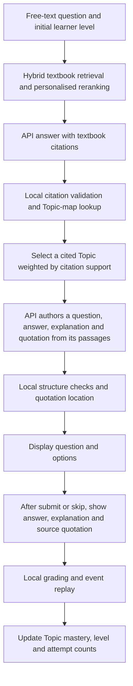

# API Learning Assistant and Online Concept Check: Framework v3

Recorded 2026-10-29. This document replaces the initial v2 design in the same file
and records the online approach chosen after the user tried the Demo. The baseline
was main@573a80c. At that snapshot, implementation was in the local
`codex/api-learning-demo` worktree; publishing this document did not mean it had
merged into main. Later Demo integration and definition updates are in
[PR #219](https://github.com/yshe0376/cs30-personalised-rag/pull/219).
This English translation preserves the v3 snapshot below.

## 1. Goals and Boundaries

One page supports free-text questions, textbook citations, Concept Checks, answer
explanations and a learner profile updated by Topic. Answer and question authoring
use APIs; retrieval, Topic mapping, quotation location, grading and event replay
run locally. Online practice comes from the textbook passages actually cited by
the current answer, not from Gold questions used as an online question bank.
Online drafts never enter the formal published pool. This workflow does not change
M7/M8, Gold Dev/Test or formal experiment rules.

## 2. End-to-End Framework

## 3. Topic Scope and Selection

- `[demo].topic_ids = ["*"]` enables all registered Topics; the current asset snapshot contains 2,520 Topics.
- Consider only Topics mapped to chunks whose citations passed validation for this answer, intersected with the registry.
- A cited passage may map to multiple Topics; one-Topic-per-passage is no longer required.
- Citation support reuses the resolver's rank-weighted support: divide contributions by citation rank and the number of Topics assigned to each chunk, then normalise.
- Candidates require a corresponding cited passage and positive support. Select a sole candidate directly; sample among multiple candidates proportionally to their support.
- A unique winner and support of 0.5 are no longer online selection gates. Citation support is separate from Dense/BM25 weights and reranking lambda.
- After selecting a Topic, the author receives only passages associated with it and actually cited by this answer.
- No question is produced when valid mappings are absent, assets disagree or valid citations are missing. Enabling the registry does not imply complete textbook mapping coverage.
- The policy is `online-demo-cited-topic-weighted-v2`; audit records include candidates, support, citations, random seed and selected Topic.

## 4. Authoring Answers and Explanations from Source Text

The author first selects a fact in the supplied textbook passages relevant to the
Topic, then writes a four-option question about it, locates the answer in the same
passage and explains the answer. Each API response has six required fields:

| Field | Content |
|---|---|
| `question` | Question stem |
| `options` | Four options in A-D order; canonical output is four `text` objects |
| `correct_answer` | A-D answer selected by the author from the source |
| `rationale` | Explanation supported by the textbook |
| `evidence_chunk_id` | A textbook chunk ID supplied in this round |
| `evidence_quote` | A contiguous source quotation from that chunk; the prompt requires at least 40 characters |

The author uses `json_schema`. Parsing also accepts ordered string arrays and A-D
dictionaries. Local checks validate required fields, four nonblank distinct
options, a valid answer label, membership of the chunk in validated citations,
and quotation/chapter-offset location. Local location proves that the quotation
exists, not that the question, answer or explanation is semantically correct.

At the user's explicit request, independent review API calls and separate gates
for answer uniqueness, semantic support and cross-model answer agreement are
removed. The author supplies the answer and explanation from the textbook;
this mode is not described as independently reviewed or verified correct.
Formatting or quotation-location failure allows at most one more author attempt.
After two failures, the page displays each attempt's failure reason.

## 5. Display, Attempts and Learner Profiles

- Before submission, show the question, options, Topic and source labels. After submit or skip, show the answer, explanation and textbook quotation.
- Grade locally against the author's answer label. Skipping does not change mastery; normal attempts write events under the existing rules.
- Reuse `JsonlEventStore` / `EventReplayer` rules for deduplication, level changes, revocation and manual level overrides.
- Mastery may change without a level change. The sidebar prioritises the actual Concept Check Topic and can switch to previously practised Topics.
- Manual level changes require a reason and saving. The initial level remains the session baseline and is not rewritten by a single Topic override.
- Comparison levels only compare answers. Choose a new learner's initial level through the new-session control.
- Questions, answers, options, explanations and comparison answers share handling for common LaTeX delimiters; stored textbook source text remains unchanged.
- A locally located quotation is marked `evidence_bound`; the question remains `draft`. No independent model-review or human-review record is created.

## 6. API Requests and State

Each answer uses at most 2 requests. Each Concept Check normally uses 1 author
request and at most 2. Up to three Concept Check questions may be requested per answer;
answer comparison is a separate operation. No reviewer client is constructed or called.
The persistent total increments before sending, including failed requests, and
does not reset on refresh, a new session or restart. A request cap is not the
provider account balance. Keys stay in ignored local environment files; indexes,
model weights, events, request ledgers and local TOML are not uploaded with these documents.

## 7. Local Implementation Entry Points

| File | Responsibility |
|---|---|
| `src/cs30/learning/config.py` / `assets.py` | Configuration, all-Topic scope and asset identity checks |
| `src/cs30/learning/topic_selection.py` | Citation-supported weighted Topic selection and auditing |
| `src/cs30/learning/online_quiz.py` | Textbook question authoring, structure checks and local quotation location |
| `src/cs30/learning/runtime.py` | Answers, practice, events, profiles and request budget |
| `src/cs30/ui/learning_app.py` / `learning_views.py` | Unified page, sidebar, attempts and textbook explanations |
| `src/cs30/ui/math_markdown.py` | Formula display adaptation for generated content |

## 8. Validation Snapshot and Follow-up Work

At the recorded snapshot, 17 related offline tests and the corresponding Ruff
checks passed; the earlier asset preflight returned ready. These checks are not
measurements of live question correctness, all-Topic coverage or personalisation
effectiveness. User trials had exercised speed-of-light question generation and
grading, but the complete combined version had not received a new paid end-to-end
acceptance run. The historical 8/10 unique retrieval-Topic resolution rate covers
only the old small sample, not all Topics.

Next, sample across textbooks and Topics, manually check question/answer/explanation
alignment to the source, and record generation success and failure categories.
If raw author responses are needed for development diagnosis, implement private
local retention and a retention policy separately; per-attempt page diagnostics
are not a complete response archive.

See the [task checklist](../plans/2026-10-28-api-learning-demo.md) and
[runbook](../../api-learning-demo-runbook.md).
