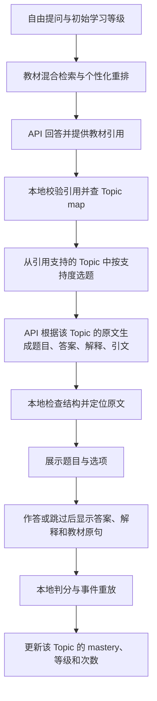

# API 学习助手与在线 Concept Check：当前框架 v3

整合补充（2026-10-29）：这些在线规则已接入 M8 的 `qa_app.py`，通过
`Online learning · textbook quizzes` 模式使用；`learning_app.py` 现为同一页面的兼容入口。
M8 的 Team V2 对照与离线 fixture 模式保留。下文的原实现基线和验证记录为历史记录。

更新：2026-10-29。本文替代同文件的 v2 首版设计，记录用户在 Demo 试用后确定的在线路线。
基线为 main@573a80c；相关实现目前位于本地 `codex/api-learning-demo` 工作区，文档发布不代表代码已合并 main。

## 1. 目标与边界

统一页面支持自由提问、教材引用、Concept Check、答案解释与按 Topic 更新的学习画像。
回答和出题使用 API；检索、Topic 映射、引文定位、判分和事件重放在本地执行。
在线题来源是当前回答实际引用的教材片段，不使用 Gold 问题充当在线练习题库。
在线草稿不写入正式 published 题库，本流程不改变 M7/M8、Gold Dev/Test 或正式实验规则。

## 2. 端到端框架

## 3. Topic 范围和选题规则

- `[demo].topic_ids = ["*"]` 开放全部注册 Topic；当前资产注册了 2,520 个 Topic。
- 只考虑当前回答通过引用校验的 chunk 所映射的 Topic，并与注册表相交。
- 同一个教材片段允许关联多个 Topic，不再要求单个片段唯一对应一个 Topic。
- 引用支持度沿用 resolver 的排名加权支持：先按引用排名和 chunk 的 Topic 数量分摊，再归一化。
- 候选须有对应的引用片段且支持度大于零；一个候选直接选，多个候选按支持度加权随机选择。
- 不再以唯一胜出或支持度 0.5 作为在线选题门槛。支持度与 Dense/BM25 权重、重排 λ 是不同量。
- 选定 Topic 后，作者只接收与它关联、且被本次回答引用的教材片段。
- 缺少有效映射、资产不一致或没有有效引用时仍不出题；开放注册表不等于教材映射全覆盖。
- 策略为 `online-demo-cited-topic-weighted-v2`，审计记录包含候选、支持度、引用、随机种子和选定 Topic。

## 4. 根据原文生成答案与解释

作者首先在所给教材片段中选取与 Topic 相关的事实，再据此生成四选一练习题，回到同一片段定位答案并解释。
一次 API 响应包含六个必填字段：

| 字段 | 内容 |
|---|---|
| `question` | 题干 |
| `options` | 按 A–D 排列的四个选项，规范输出为四个 `text` 对象 |
| `correct_answer` | 模型依据原文给出的 A–D 答案 |
| `rationale` | 依据教材说明答案的解释 |
| `evidence_chunk_id` | 本轮传入的教材 chunk ID |
| `evidence_quote` | 对应 chunk 中的连续原句，提示词要求至少 40 字符 |

出题角色采用 `json_schema`。解析兼容 `text` 对象数组、字符串数组和 A–D 字典。
本地检查字段、四个非空且不重复的选项、合法答案标签、chunk 是否来自有效引用，并定位引文及章节偏移。
本地引文定位只能证明原句存在，不能证明题目、答案或解释在语义上正确。

按用户明确要求，取消独立复核 API，以及独立判断答案唯一性、语义支持度和模型间答案一致性的门槛。
题目的答案与解释由作者根据教材提供，不将此模式描述为已独立审查或已验证正确。
格式或引文定位失败时最多再尝试一次；两次失败后显示逐次失败原因。

## 5. 展示、作答与画像

- 作答前展示题干、选项、Topic 与来源标签；提交或跳过后展示答案、解释和教材原句。
- 按模型给出的答案标签本地判分；跳过不更新 mastery，正常作答按现有规则写事件。
- 复用 `JsonlEventStore` / `EventReplayer` 的去重、升降级、撤销和手动等级覆盖规则。
- mastery 可以改变而等级暂不改变；侧栏优先显示实际 Concept Check Topic，并可切换历史练习 Topic。
- 手动调整等级填写原因并保存；初始等级显示会话基线，不会随单个 Topic 的覆盖而改写。
- 对比等级仅用于比较回答；新学习者初始等级通过新会话入口选择。
- 问答、题目、选项、解释与对比回答统一处理常见 LaTeX 分隔符；教材原文记录保持原样。
- 引文通过本地定位标记 `evidence_bound`，题目仍为 `draft`；不生成独立复核或人工审核记录。

## 6. API 与状态

每次回答最多 2 次请求；每个 Concept Check 正常 1 次、最多 2 次作者请求。
每轮回答最多请求三道 Concept Check；对比回答是单独操作。不会构造或调用复核客户端。
持久总计在发送前计数，失败也计入；刷新、换会话和重启不清零。次数上限不等于平台余额。
密钥保存在忽略的本地环境文件；索引、模型权重、事件、账本和本地 TOML 不随框架文档上传。

## 7. 本地实现入口

| 文件 | 职责 |
|---|---|
| `src/cs30/learning/config.py` / `assets.py` | 配置、全部 Topic 范围和资产身份检查 |
| `src/cs30/learning/topic_selection.py` | 引用支持的 Topic 加权选题及审计 |
| `src/cs30/learning/online_quiz.py` | 教材出题、结构检查和本地引文定位 |
| `src/cs30/learning/runtime.py` | 问答、练习、事件、画像与请求预算 |
| `src/cs30/ui/learning_app.py` / `learning_views.py` | 统一页面、侧栏、作答与教材解释 |
| `src/cs30/ui/math_markdown.py` | 生成内容的公式显示适配 |

## 8. 验证状态与后续工作

本轮本地相关离线用例共 17 项通过，相关 Ruff 检查通过。此前资产预检返回 ready。
这些验证不等于真实 API 题目正确率、全部 Topic 覆盖率或个性化效果评估。
用户试用已观察到光速题生成与判分；当前完整组合版本未执行新的付费端到端验收。
历史 8/10 唯一检索 Topic 解析率仅对应小样本旧范围，不能当作全部 Topic 的成功率。

下一步按教材和 Topic 分层抽样，人工核对题干、答案、解释及原文对应关系，记录出题成功率和失败类型。
若需保留原始作者响应作开发诊断，应单独实现本地私有日志与保留策略；现有页面逐次诊断不等于完整响应归档。

参见 [整合任务清单](../plans/2026-10-29-m8-online-quiz.md)、[运行说明](../../api-learning-demo-runbook.md)。
