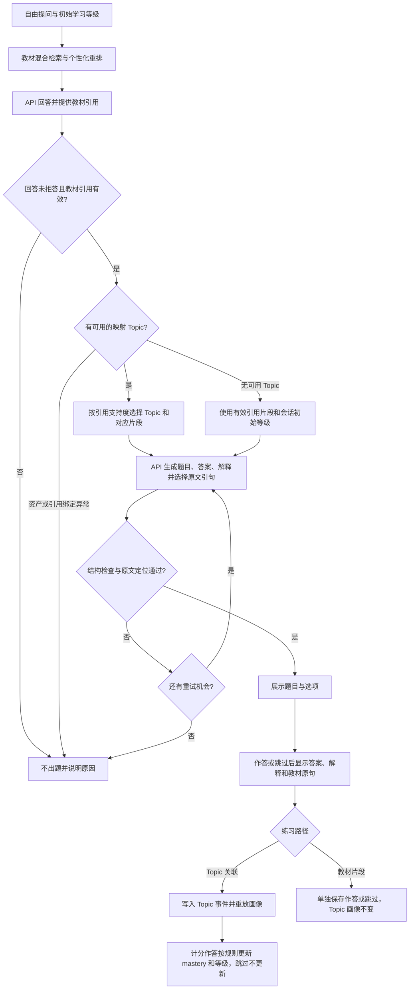

# 在线 Concept Check：当前概念与框架 v5

更新：2026-10-29。本文是当前在线 Demo 的定义与行为说明，替代同文件 v2–v4 中与之不一致的描述。
实现随 [PR #219](https://github.com/yshe0376/cs30-personalised-rag/pull/219) 提交，
入口是 M8 的 `qa_app.py` → `Online learning · textbook quizzes`；
`learning_app.py` 为同一页面的兼容入口。Team V2 对照与离线 fixture 模式仍使用各自流程。

2026-09-21 的[首版设计](2026-09-21-concept-check-design.md)保留为已审核题库路线的历史规格与共享契约依据，
不再作为当前在线 Demo 的完整产品定义。正式题库发布门槛和正式实验规则并未因此放宽。

## 1. 目标与边界

**Concept Check 是回答之后由学习者主动触发、以本次回答实际引用的教材为依据的简短理解练习。**
它提供题目、作答反馈、解释和可定位的原文；只有具备有效 Topic 归属的计分作答可用于更新 Topic 学习画像。
因此，“可以进行理解练习”与“可以据此更新画像”是两个不同条件。

| 当前 Demo 的两条路径 | Topic 关联练习 | 教材片段练习（回退） |
|---|---|---|
| 触发条件 | 有符合范围且有引用支持的 Topic | 有有效教材引用，但没有可用的映射 Topic |
| 出题材料 | 当前回答引用且映射到所选 Topic 的片段 | 当前回答的有效引用片段，围绕原提问出题 |
| 难度 | 所选 Topic 当前状态对应的目标等级 | 当前学习会话的初始等级 |
| 题目、答案与解释 | API 根据所给教材生成 | API 根据所给教材生成 |
| 提交与跳过后的反馈 | 本地判分，展示答案、解释与原文 | 本地判分，展示答案、解释与原文 |
| Topic mastery 与等级 | 有效计分作答按现有规则更新；跳过不更新 | 不分配或猜测 Topic，不更新 |
| 保存位置 | `JsonlEventStore` 的 Topic 事件流 | 会话目录下的 `textbook_practice_attempts.jsonl` |
| Topic 报表与撤销 | 纳入 Topic 报表；可撤销最近有效计分作答 | 不纳入 Topic 报表或 Topic 作答撤销 |

统一页面支持自由提问、教材引用、Concept Check、答案解释与按 Topic 更新的学习画像。
回答和出题使用 API；检索、Topic 映射、引文定位、判分和事件重放在本地执行。
在线题来源是当前回答实际引用的教材片段，不使用 Gold 问题充当在线练习题库。
两条路径都是当前在线 Demo 的即时草稿，不宣称已通过独立语义审核，也不写入正式 `published` 题库。
本流程不改变 M7/M8、Gold Dev/Test 或正式实验规则。

## 2. 端到端框架

## 3. Topic 范围和选题规则

- `[demo].topic_ids = ["*"]` 开放全部注册 Topic；当前资产注册了 2,520 个 Topic。
- 只考虑当前回答通过引用校验的 chunk 所映射的 Topic，并与注册表相交。
- 同一个教材片段允许关联多个 Topic，不再要求单个片段唯一对应一个 Topic。
- 引用支持度沿用 resolver 的排名加权支持：先按引用排名和 chunk 的 Topic 数量分摊，再归一化。
- 候选须有对应的引用片段且支持度大于零；一个候选直接选，多个候选按支持度加权随机选择。
- 不再以唯一胜出或支持度 0.5 作为在线选题门槛。支持度与 Dense/BM25 权重、重排 λ 是不同量。
- 选定 Topic 后，作者只接收与它关联、且被本次回答引用的教材片段。
- 缺少可用映射时直接以有效教材引用出题；资产不一致或没有有效引用时仍不出题。
  开放注册表不等于教材映射全覆盖，教材回退题不更新 Topic 画像。
- 策略为 `online-demo-cited-topic-weighted-v2`，审计记录包含候选、支持度、引用、随机种子和选定 Topic。

## 4. 根据原文生成答案与解释

Topic 路径要求作者在所给教材片段中选取与选定 Topic 相关的事实；教材路径则围绕原提问，
从有效引用片段中选取事实，不生成或猜测 Topic ID。两者都据此生成四选一题、答案和解释。
一次 API 响应包含六个必填字段：

| 字段 | 内容 |
|---|---|
| `question` | 题干 |
| `options` | 按 A–D 排列的四个选项，规范输出为四个 `text` 对象 |
| `correct_answer` | 模型依据原文给出的 A–D 答案 |
| `rationale` | 依据教材说明答案的解释 |
| `evidence_chunk_id` | 本轮传入的教材 chunk ID |
| `evidence_quote` | 从对应 chunk 的 `allowed_quotes` 中选择的连续原文，至少 40 字符 |

出题角色采用 `json_schema`。解析兼容 `text` 对象数组、字符串数组和 A–D 字典。
本地检查字段、四个非空且不重复的选项、合法答案标签、chunk 是否来自有效引用，并定位引文及章节偏移。
本地引文定位只能证明原句存在，不能证明题目、答案或解释在语义上正确。

按用户明确要求，取消独立复核 API，以及独立判断答案唯一性、语义支持度和模型间答案一致性的门槛。
题目的答案与解释由作者根据教材提供，不将此模式描述为已独立审查或已验证正确。
出题输入包含从教材提取且预先通过唯一定位的 `allowed_quotes`，每次请求的 schema
限制引句和 chunk ID 的可选范围，返回后仍执行本地定位与共享 span 绑定。
格式或引文定位失败时最多再尝试一次，并传回具体纠错信息；两次失败后显示逐次失败原因。
后续练习的提示词包含当前回答已出过的题干，要求生成不同的问题。

## 5. 展示、作答与画像

- 作答前展示题干、选项、来源与练习路径；仅 Topic 路径展示已选 Topic。
  提交或跳过后展示答案、解释和教材原句。
- 两条路径都按作者给出的答案标签本地判分；判分结果表示是否选中作者答案，不等于独立验证题目正确。
- Topic 路径写入提交或跳过事件，复用 `JsonlEventStore` / `EventReplayer` 的去重、升降级、撤销和手动等级覆盖规则。
  跳过不更新 mastery；计分作答可以改变 mastery，但等级仍须满足既有升降级条件。
- 教材路径保存独立作答记录，返回当前画像，不写入 Topic 事件流，也不把成绩归到检索阶段的另一个 Topic。
  “撤销最近计分作答”和报表中的 Topic 统计只适用于 Topic 事件。
- mastery 可以改变而等级暂不改变；侧栏优先显示实际 Concept Check Topic，并可切换历史练习 Topic。
- 手动调整等级填写原因并保存；初始等级显示会话基线，不会随单个 Topic 的覆盖而改写。
- 对比等级仅用于比较回答；新学习者初始等级通过新会话入口选择。
- 问答、题目、选项、解释与对比回答统一处理常见 LaTeX 分隔符；教材原文记录保持原样。
- 引文通过本地定位标记 `evidence_bound`，题目仍为 `draft`；不生成独立复核或人工审核记录。
- 没有可用 Topic 才回退到教材片段。拒答、引用无效、引用不在当前检索中或资产身份不一致时仍停止；
  Topic 路径的作者请求失败不会额外开启一组教材回退请求。

## 6. API 与状态

每次回答最多 2 次请求；每个 Concept Check 正常 1 次、最多 2 次作者请求。
每轮回答最多请求三道 Concept Check；对比回答是单独操作。不会构造或调用复核客户端。
持久总计在发送前计数，失败也计入；刷新、换会话和重启不清零。次数上限不等于平台余额。
密钥保存在忽略的本地环境文件；索引、模型权重、事件、账本和本地 TOML 不随框架文档上传。

## 7. 本地实现入口

| 文件 | 职责 |
|---|---|
| `src/cs30/learning/config.py` / `assets.py` | 配置、全部 Topic 范围和资产身份检查 |
| `src/cs30/learning/topic_selection.py` | 引用支持的 Topic 加权选题及审计 |
| `src/cs30/learning/online_quiz.py` | 教材出题、结构检查和本地引文定位 |
| `src/cs30/learning/runtime.py` | 问答、练习、事件、画像与请求预算 |
| `src/cs30/ui/qa_app.py` / `qa_learning.py` / `learning_views.py` | 统一页面、侧栏、作答与教材解释 |
| `src/cs30/ui/learning_app.py` | 同一页面的兼容启动入口 |
| `src/cs30/ui/math_markdown.py` | 生成内容的公式显示适配 |

## 8. 验证状态与后续工作

截至本轮实现验证，本地全项目测试 1,477 项通过、1 项跳过，仓库 Ruff 检查通过；本地资产预检返回 ready。
这些验证不等于真实 API 题目正确率、全部 Topic 覆盖率或个性化效果评估。
已对实际“小球下落”教材片段进行一次第 2 题的最小在线出题验证，引句绑定成功，使用 1 次作者请求。
这只验证该请求和引句路径，不代表完整付费端到端验收或普遍成功率。
历史 8/10 唯一检索 Topic 解析率仅对应小样本旧范围，不能当作全部 Topic 的成功率。

后续应分别统计 Topic 关联练习与教材片段练习的出题率、失败类型和人工核对结果，
并检查连续出题的重复情况。Topic 画像的变化只在 Topic 路径统计。
若需保留原始作者响应作开发诊断，应单独实现本地私有日志与保留策略；现有页面逐次诊断不等于完整响应归档。

参见 [整合任务清单](../plans/2026-10-29-m8-online-quiz.md)、[运行说明](../../api-learning-demo-runbook.md)。

## 9. 与首版设计的关系

| 首版设计中的概念 | 当前在线 Demo 中的定义 |
|---|---|
| 从已审核并发布的练习题池选题 | API 根据当前回答的教材引用即时生成草稿；不自动发布 |
| Topic 是提供练习与更新状态的共同前提 | Topic 是进入自适应画像的前提；有效教材引用足以支持非画像练习 |
| 必须能确定单一胜出 Topic，否则不提供练习 | 可对多个引用支持的 Topic 加权选择；没有可用 Topic 时使用教材路径 |
| 题库的答案与解释须经过独立审核 | 作者提供答案与解释，本地核对结构与引文；没有独立语义复核 |
| 作答进入 Topic 学习事件与报表 | 仅 Topic 路径进入；教材路径另存记录 |

首版中的已审核题库发布规则、共享 `ConceptCheckQuestion` 的 Topic 要求和正式静态画像实验边界继续有效。
在线教材回退使用局部类型 `TextbookQuizQuestion`，不通过伪造 Topic 或修改共享契约适配题库。
当前产品名 Concept Check 覆盖两类理解练习；它不再意味着每一题都能测量并更新某个 Topic 的掌握度。
