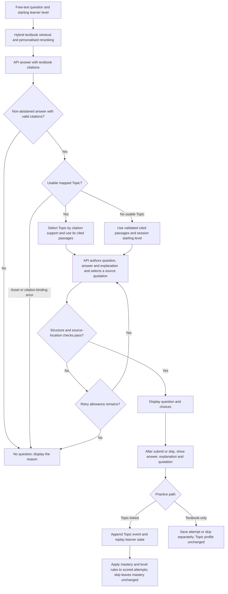

# Online Concept Check: Current Definition and Framework v5

Updated 2026-10-29. This is the definition and behaviour of the current online Demo.
It supersedes inconsistent descriptions in versions v2–v4 of this document.
Implementation is submitted in [PR #219](https://github.com/yshe0376/cs30-personalised-rag/pull/219).
The entry is M8's `qa_app.py` → `Online learning · textbook quizzes`;
`learning_app.py` is a compatibility entry for the same page. Team V2 comparison
and offline fixture modes retain their own workflows.

The [2026-09-21 first design](2026-09-21-concept-check-design.md) remains the
historical specification for the reviewed question-pool route and a reference for
shared contracts, rather than the complete product definition of this online Demo.
Formal question-pool publication gates and experiment rules have not been relaxed.

## 1. Purpose and Boundaries

**A Concept Check is a short, learner-requested comprehension exercise after an
answer, grounded in the textbook passages actually cited by that answer.**
It offers a question, feedback, explanation and locatable source quotation. Only
scored attempts with a valid Topic assignment may update the Topic learner profile.
Practice availability and eligibility to update the profile are separate conditions.

| Current Demo path | Topic-linked practice | Textbook-only fallback practice |
|---|---|---|
| When offered | An in-scope Topic has supporting citations | Valid textbook citations exist but no usable mapped Topic is available |
| Authoring material | Passages cited by this answer and mapped to the selected Topic | This answer's validated cited passages, focused on the original learner question |
| Difficulty | Target level from the selected Topic's current state | The learning session's starting level |
| Question, answer and explanation | API-authored from the supplied textbook text | API-authored from the supplied textbook text |
| Feedback after submit or skip | Local grading, answer, explanation and quotation | Local grading, answer, explanation and quotation |
| Topic mastery and level | Existing rules apply to valid scored attempts; skipping does not update mastery | No Topic is assigned or guessed; no update |
| Storage | Topic event stream in `JsonlEventStore` | `textbook_practice_attempts.jsonl` in the session directory |
| Topic reports and undo | Included in Topic reports; latest valid scored attempt may be revoked | Excluded from Topic reports and Topic-attempt undo |

The unified page supports free-text questions, textbook citations, Concept Checks,
answer explanations and Topic-based learner profiles. Answer and question authoring
use APIs; retrieval, Topic mapping, quotation location, grading and event replay
run locally. Online practice uses actual cited textbook passages, not Gold
questions as an online practice bank. Both paths produce immediate Demo drafts,
without claiming independent semantic review or entering the formal `published`
pool. M7/M8, Gold Dev/Test and formal experiment rules are unchanged.

## 2. End-to-End Flow

## 3. Topic Scope and Selection

- `[demo].topic_ids = ["*"]` enables all registered Topics; the asset snapshot contains 2,520 Topics.
- Consider only Topics mapped to this answer's citation-validated chunks, intersected with the registry.
- One cited passage may support multiple Topics; a unique Topic per passage is not required.
- Reuse resolver rank-weighted citation support: divide contributions by citation rank and the number of assigned Topics, then normalise.
- A candidate needs a corresponding cited passage and positive support. Select one candidate directly, or sample proportionally to support when several qualify.
- A unique winner and support of 0.5 are not online selection gates. This support differs from Dense/BM25 weights and reranking lambda.
- After Topic selection, the author receives only passages mapped to that Topic and actually cited by this answer.
- When no usable mapping is available, generate directly from valid cited textbook passages. Asset mismatches or missing valid citations still block generation.
- Enabling the registry does not imply complete mapping coverage. Textbook-only practice never updates the Topic profile.
- `online-demo-cited-topic-weighted-v2` records candidates, support, citations, random seed and selected Topic for audit.

## 4. Authoring from Source Text

The Topic path asks the author to choose a fact relevant to the selected Topic from
the supplied passages. The textbook-only path asks for a fact from validated cited
passages relevant to the learner's original question, without inventing a Topic ID.
Both generate a four-option question, answer and explanation. Each API response
has six required fields:

| Field | Content |
|---|---|
| `question` | Question stem |
| `options` | Four options ordered A-D, canonically four `text` objects |
| `correct_answer` | The author's A-D answer based on the source |
| `rationale` | Explanation based on the textbook |
| `evidence_chunk_id` | A textbook chunk supplied in this round |
| `evidence_quote` | Contiguous source text selected from that chunk's `allowed_quotes`, at least 40 characters |

The author uses `json_schema`. Parsing also accepts ordered string arrays and A-D
dictionaries. Local checks cover required fields, four nonblank distinct options,
valid answer labels, chunk membership in validated citations, and quotation/chapter
offset location. Locating source text does not independently establish the
semantic correctness of a question, answer or explanation.

At the user's explicit request, there is no independent review API or separate
gate for answer uniqueness, semantic support or cross-model answer agreement.
The author supplies answers/explanations; this mode is not described as
independently reviewed or verified correct. Input includes `allowed_quotes`
pre-extracted from the textbook and checked for unique location. Each request's
schema constrains quotations and chunk IDs; returned text still passes local
location and the shared span-binding resolver. A formatting or location failure
allows at most one retry, with specific corrective feedback; two failures show
both attempt reasons. Later quizzes include prior question stems and ask for
different questions.

## 5. Display, Attempts and Learner Profiles

- Before answering, show the question, choices, source and practice path. Only the Topic path shows a selected Topic. After submit or skip, show the answer, explanation and quotation.
- Both paths grade locally against the author's answer label. A grade indicates agreement with that label, not independent proof of correctness.
- Topic practice appends submit/skip events and reuses `JsonlEventStore` / `EventReplayer` rules for deduplication, level changes, revocation and reason-required manual overrides. Skipping does not update mastery; scored attempts may change mastery without meeting the conditions for a level change.
- Textbook practice saves a separate record and returns the existing learner state. It writes no Topic event and does not attribute performance to an unrelated retrieval-stage Topic. Topic statistics and undo apply only to Topic events.
- The sidebar prioritises actual quiz Topics and allows historical Topic selection. The session's starting level remains a baseline, unaffected by individual Topic overrides.
- Comparison levels only compare answers. A new learner's starting level is selected through the new-session control.
- Generated questions, answers, choices, explanations and comparisons share common LaTeX-delimiter handling; stored textbook text is unchanged.
- Local quotation binding is marked `evidence_bound`; questions remain `draft`, without independent model-review or human-review records.
- Fallback is for absent usable Topics. Abstention, invalid citations, citations outside retrieval and asset-identity mismatches still stop generation. Author failure on the Topic path does not open an extra set of fallback requests.

## 6. API Requests and State

Each answer permits at most 2 requests. A Concept Check normally needs 1 author
request and permits at most 2. Up to three Concept Check questions may be requested
for an answer. Comparison is separate; no reviewer client is constructed or called.
The persistent total increments before sending, including failures. Refresh,
new sessions and restarts do not reset it. A request cap is not a provider balance.
Keys stay in ignored environment files. Indexes, weights, events, ledgers and local
TOML configuration are not uploaded with the framework documents.

## 7. Implementation Entry Points

| File | Responsibility |
|---|---|
| `src/cs30/learning/config.py` / `assets.py` | Configuration, Topic scope and asset identities |
| `src/cs30/learning/topic_selection.py` | Citation-supported weighted Topic selection and audit |
| `src/cs30/learning/online_quiz.py` | Textbook authoring, structural checks and quotation location |
| `src/cs30/learning/runtime.py` | Answers, practice, events, profiles and request budgeting |
| `src/cs30/ui/qa_app.py` / `qa_learning.py` / `learning_views.py` | Unified page, sidebar, attempts and explanations |
| `src/cs30/ui/learning_app.py` | Compatibility entry for the same page |
| `src/cs30/ui/math_markdown.py` | Formula display adaptation |

## 8. Validation Snapshot and Follow-up

The preceding implementation validation reported 1,477 passing tests and one skip,
with repository Ruff checks passing and local asset preflight ready. These checks
do not measure live question correctness, all-Topic coverage or personalisation
effectiveness. A minimal live check generated a second question from the actual
falling-ball passage and successfully bound its quotation, using one author
request. This verifies that request/quotation path, not full paid end-to-end
acceptance or a general success rate. The historical 8/10 unique retrieval-Topic
resolution result covers an old small sample, not all Topics.

Future reporting should separate generation availability, failure categories and
manual source-alignment checks for Topic-linked and textbook-only practice, and
check repeated questions across consecutive quizzes. Report profile changes only
for the Topic path. Full raw author-response retention, if needed for diagnosis,
requires a separate private logging/retention implementation; page summaries are
not a complete response archive.

See the [integration checklist](../plans/2026-10-29-m8-online-quiz.md) and
[runbook](../../api-learning-demo-runbook.md).

## 9. Relationship to the First Design

| First design | Current online Demo |
|---|---|
| Select from a reviewed and published practice pool | API-authored drafts from this answer's citations, without automatic publication |
| Topic identity is required both to offer practice and update state | Topic identity is required for adaptive profile updates; valid source citations permit practice without it |
| A single winning Topic is required, otherwise no question | Weighted selection among supported Topics, with textbook-only fallback when none is usable |
| Question-pool answers/explanations require independent review | The author provides answers/explanations; local checks validate structure and quotations, without independent semantic review |
| Attempts enter Topic events and reports | Only Topic-linked attempts enter those streams; textbook-only records are separate |

The original publication gates, the shared `ConceptCheckQuestion` Topic requirement
and formal static-profile experiment boundaries remain. Textbook fallback uses the
local `TextbookQuizQuestion` type instead of inventing a Topic or modifying shared
contracts to enter the pool. The product name Concept Check covers both kinds of
comprehension practice; it does not imply that every question measures or updates
mastery of a registered Topic.
